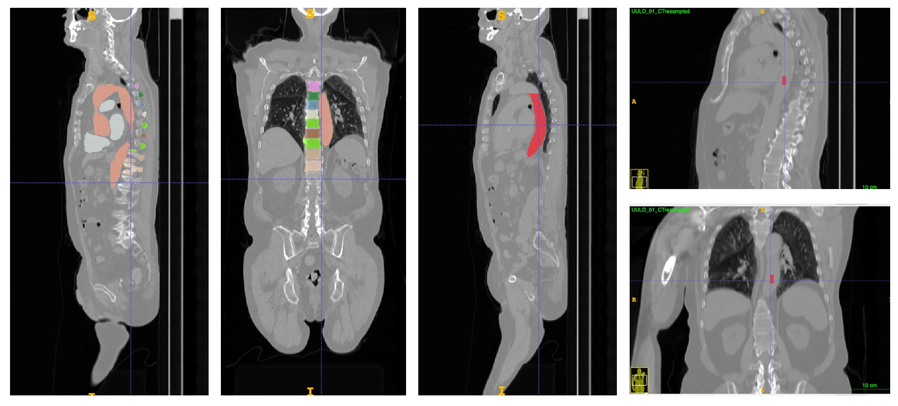

# Automated descending-aorta IDIF extraction

**Author:** Camila Silva, University of Bern — developed in April 2026 as part
of the master's thesis *Deep Learning-Based Whole-Body Tumor Segmentation: Comparison of Static and Parametric 18F-FDG PET/CT*.

Automated extraction of an **image-derived input function (IDIF)**
from the descending thoracic aorta, for Patlak parametric imaging on the
Biograph Vision Quadra (LAFOV PET/CT).

Generating Patlak parametric maps needs, besides the dynamic PET series, an
arterial input function. Instead of invasive arterial blood sampling, the LAFOV
scanner lets us measure it non-invasively as an IDIF from a large blood pool.
The **descending thoracic aorta** is used here: its large lumen limits
partial-volume effects and its position against the posterior chest wall keeps
it stationary relative to cardiac/respiratory motion (unlike the left
ventricle, where myocardial spill-over increases variance) [Sari et al. 2022; Sari et al. 2023].

This pipeline replaces manual delineation of the descending
aorta with a fully automated algorithm that derives the VOI directly from the
co-registered CT using [TotalSegmentator](https://github.com/wasserthal/TotalSegmentator)
[Wasserthal et al.].



*From left to right: (1–2) TotalSegmentator output — aorta, heart and
vertebrae T4–T12 (sagittal, coronal); (3) isolated descending thoracic aorta;
(4) cylindrical IDIF VOI (red) placed at the cranio-caudal midpoint
(sagittal, coronal).*

## What the code does

For each CT it runs three steps:

1. **Anatomical segmentation.** TotalSegmentator segments the whole aorta, the
   heart and the thoracic vertebrae T4–T12. The vertebrae and heart are used as
   anatomical landmarks.

2. **Isolation of the descending aorta** (`extract_descending_aorta.py`).
   Boundaries follow the SEQUOIA aortic framework [van Praagh et al.]:
   - restrict the aorta to the T4–T12 cranio-caudal range (thoracic level);
   - remove the arch / ascending aorta by cutting 3 slices above the top of
     the heart;
   - remove the abdominal aorta by cutting below the top of T12 (diaphragmatic
     landmark);
   - split anterior–posterior and keep the posterior portion;
   - keep the largest connected component (removes stray fragments).

3. **Definition of the reference VOI** (`area_of_interest_aorta.py`).
   A cylindrical IDIF sampling volume is derived from the descending-aorta mask:
   - erode the mask in-plane by 2 voxels to move inside the lumen, away from
     the wall (reduces partial-volume contamination) [Sari et al. 2022; Hu et al.];
   - place a **10 mm diameter × 20 mm long** cylinder at the cranio-caudal
     midpoint, intersected with the eroded lumen (so in a narrow aorta the VOI
     can be smaller than the full cylinder).

Optionally, `pet_mean_values.py` computes the IDIF value = mean PET intensity
inside the VOI for each patient.

Images are internally reoriented to RAS, so any CT orientation works; all
output masks are saved on the grid of the input CT.

## Folder layout

```
<repo>/
├── CT_scans/                    # INPUT  – one CT per patient (you add these)
├── intermediate_files/          # created: TotalSegmentator multilabel output
├── final_masks/                 # created: descending-aorta mask + IDIF VOI
├── logs/                        # created: SLURM logs
├── run_pipeline.sh              # orchestrator (local or SLURM)
├── extract_descending_aorta.py  # step 2
├── area_of_interest_aorta.py    # step 3
├── pet_mean_values.py           # optional: IDIF mean PET value -> CSV
├── totalseg_env.yml             # conda environment (portable)
├── totalseg_env_lock_linux.yml  # exact environment used in the thesis
└── docs/                        # README figure
```

### Input: place your data in `CT_scans/`
One CT per patient, in any of these layouts:
- a NIfTI file: `CT_scans/<patient>.nii.gz` (or `.nii`);
- a patient folder with NIfTI file(s): `CT_scans/<patient>/ct.nii.gz`. If the
  folder holds several NIfTIs, the first one whose name contains "ct" is used;
- a DICOM series folder: `CT_scans/<patient>/*.dcm` (TotalSegmentator reads it).

The **patient id** is the file name without extension (or the folder name).
Every output for that patient is prefixed with this id.

> Patient data is excluded by `.gitignore` — never commit images to the repo.

### Outputs (created automatically, `<patient>` = CT name)
| File | Location | Content |
|------|----------|---------|
| `<patient>_segmentations.nii.gz` | `intermediate_files/<patient>/` | Raw TotalSegmentator multilabel (aorta, heart, T4–T12) |
| `<patient>_des_aorta.nii.gz` | `final_masks/<patient>/` | Isolated descending-aorta mask |
| `<patient>_roi_des_aorta.nii.gz` | `final_masks/<patient>/` | Cylindrical IDIF VOI |

## Setup

Clone or download this repository, then from its folder:

```bash
conda env create -f totalseg_env.yml
conda activate totalseg_env
```

On the first run TotalSegmentator downloads its model weights (a few GB), so
the machine needs internet access once. If your cluster's compute nodes are
offline, run TotalSegmentator once on a login node first (see the
[TotalSegmentator docs](https://github.com/wasserthal/TotalSegmentator)).

## Run

Put your CTs into `CT_scans/`, then:

**Locally**

```bash
bash run_pipeline.sh                 # NVIDIA GPU
DEVICE=cpu bash run_pipeline.sh      # no GPU (slow)
DEVICE=mps bash run_pipeline.sh      # Apple Silicon
```

**On a SLURM cluster:** first edit the `#SBATCH` header in `run_pipeline.sh`
(replace `<YOUR_ACCOUNT>` and `<YOUR_GPU_PARTITION>`, and the GPU type / time
if needed), then submit from the repo folder:

```bash
mkdir -p logs
sbatch run_pipeline.sh
```

If your cluster uses different module names than `Anaconda3` / `CUDA`, edit
the `module load` lines too (failures there are ignored).

### Options (environment variables)

| Variable | Default | Meaning |
|----------|---------|---------|
| `DEVICE` | `gpu` | TotalSegmentator device: `gpu`, `cpu`, or `mps` |
| `MAX_CASES` | `-1` | Process only the first N cases (`-1` = all) |
| `FORCE` | `0` | `1` = recompute segmentations even if they exist |
| `CONDA_ENV` | `totalseg_env` | Conda environment to activate |
| `CT_DIR` | `<repo>/CT_scans` | Input folder, if your CTs live elsewhere |
| `INTERMEDIATE_DIR` | `<repo>/intermediate_files` | TotalSegmentator output folder |
| `FINAL_DIR` | `<repo>/final_masks` | Final masks folder |

Example: `CT_DIR=/data/my_cts MAX_CASES=2 bash run_pipeline.sh`

A failing case is skipped and listed at the end; the other cases still run.

## Optional — IDIF PET value

`pet_mean_values.py` averages the PET signal inside each VOI.

```bash
python pet_mean_values.py --pet-dir /path/to/pet_data
# expects  /path/to/pet_data/<patient>/pet.nii.gz

python pet_mean_values.py --pet-dir /path/to/pet_data --pet-name dynamic.nii.gz \
                          --out my_idif.csv
```

- The patient folder names under `--pet-dir` must match the patient ids in
  `final_masks/`.
- PET and CT must be co-registered (as on a PET/CT scanner), but they **do not**
  need the same grid: each VOI voxel is mapped to its nearest PET voxel via the
  image affines.
- It handles static (3-D) and dynamic (4-D) PET. For a 4-D series it writes one
  `pet_mean_f<frame>` column per frame to `aorta_roi_pet_values.csv`, together
  with the VOI volume, length and diameter. Frame times are not included; take
  the frame mid-times from your PET metadata to build the IDIF curve.

## Acknowledgement

If you use or adapt this code, please acknowledge the author (Camila Silva,
University of Bern) and cite TotalSegmentator (Wasserthal et al., 2023; see
below).

## References
- **Hu et al.** — J. Hu, V. Panin, A. M. Smith, et al., "Design and
  Implementation of Automated Clinical Whole Body Parametric PET With
  Continuous Bed Motion," *IEEE Transactions on Radiation and Plasma Medical
  Sciences*, vol. 4, no. 6, pp. 696–707, 2020.
  doi:[10.1109/TRPMS.2020.2994316](https://doi.org/10.1109/TRPMS.2020.2994316)
- **van Praagh et al.** — G. D. van Praagh, P. H. Nienhuis, M. Reijrink, et al.,
  "Automated Multiclass Segmentation, Quantification, and Visualization of the
  Diseased Aorta on Hybrid PET/CT — SEQUOIA," *Medical Physics*, vol. 51,
  no. 6, pp. 4297–4310, 2024.
  doi:[10.1002/mp.16967](https://doi.org/10.1002/mp.16967)
- **Wasserthal et al.** — J. Wasserthal, H.-C. Breit, M. T. Meyer, et al.,
  "TotalSegmentator: Robust Segmentation of 104 Anatomic Structures in CT
  Images," *Radiology: Artificial Intelligence*, vol. 5, no. 5, e230024, 2023.
  doi:[10.1148/ryai.230024](https://doi.org/10.1148/ryai.230024)
- **Sari et al. 2022** — H. Sari, C. Mingels, I. Alberts, et al., "First
  Results on Kinetic Modelling and Parametric Imaging of Dynamic 18F-FDG
  Datasets from a Long Axial FOV PET Scanner in Oncological Patients,"
  *European Journal of Nuclear Medicine and Molecular Imaging*, vol. 49, no. 6,
  pp. 1997–2009, 2022.
  doi:[10.1007/s00259-021-05623-6](https://doi.org/10.1007/s00259-021-05623-6)
- **Sari et al. 2023** — H. Sari, L. Eriksson, C. Mingels, et al.,
  "Feasibility of Using Abbreviated Scan Protocols with Population-Based Input
  Functions for Accurate Kinetic Modeling of [18F]-FDG Datasets from a Long
  Axial FOV PET Scanner," *European Journal of Nuclear Medicine and Molecular
  Imaging*, vol. 50, no. 2, pp. 257–265, 2023.
  doi:[10.1007/s00259-022-05983-7](https://doi.org/10.1007/s00259-022-05983-7)